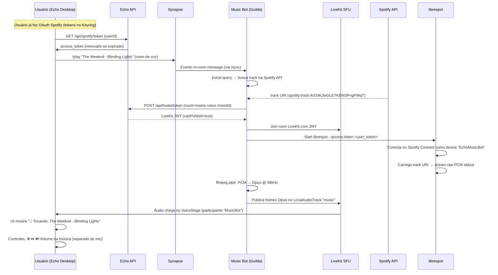

# Echo — Integração Spotify + Bot de Música por Guilda/DM

**Data:** 2026-11-06  
**Status:** Estudo técnico completo para aprovação  
**Projeto:** Cliente desktop Matrix (Tauri 2 + React/TypeScript) estilo Discord  
**Escopo:** Cada usuário integra seu próprio Spotify → Bot por guilda toca no canal de voz (LiveKit)

---

## 1. Resumo Executivo

### Objetivo
Permitir que **cada usuário** do Echo conecte sua conta Spotify (OAuth PKCE) e use comandos (`/play`, `/queue`, `/skip`) para tocar músicas no **canal de voz da guilda** ou **call privada (DM)**, via bot Matrix dedicado rodando na mesma VPS (Coolify).

### Arquitetura de Alto Nível

```
┌─────────────────────────────────────────────────────────────────────────────┐
│                         VPS ORACLE (COOLIFY)                                │
│  ┌──────────────┐  ┌──────────────┐  ┌──────────────┐  ┌────────────────┐  │
│  │   SYNAPSE    │  │  LIVEKIT SFU │  │  ECHO API    │  │  MUSIC BOT     │  │
│  │  (HOMESERVER)│  │  (VOICE SFU) │  │  (SIGNALING) │  │  (CONTAINER)   │  │
│  └──────┬───────┘  └──────┬───────┘  └──────┬───────┘  └───────┬────────┘  │
│         │                 │                 │                 │            │
│         └─────────────────┴─────────────────┴─────────────────┘            │
│                               │                                             │
│                    HTTPS / WSS (eco.litteris.online)                        │
└───────────────────────────────┼─────────────────────────────────────────────┘
                                │
                    ┌───────────┴───────────┐
                    │   ECHO DESKTOP (TAURI) │
                    │  ┌─────────────────┐   │
                    │  │ SPOTIFY OAUTH   │   │ ← Cada usuário faz PKCE
                    │  │ (PKCE + KEYRING)│   │   Tokens no Keyring do SO
                    │  └────────┬────────┘   │
                    └───────────┼───────────┘
                                │
                    ┌───────────┴───────────┐
                    │   SPOTIFY API         │
                    │   (WEB API + LIBRESPOT)│
                    └───────────────────────┘
```

### Decisões-chave já validadas

| Decisão | Justificativa |
|---------|---------------|
| **User-token model** | Cada usuário usa **seu próprio Spotify Premium**; bot apenas orquestra. Respeita ToS do Spotify. |
| **Bot por guilda (container Coolify)** | Isolamento, escalabilidade horizontal, logs independentes, deploy via Coolify nativo. |
| **MatrixRTC + LiveKit (MSC3401/4143)** | Padrão moderno Matrix; Element Call usa isso; bot publica `m.call.member` state event. |
| **librespot + pipe + ffmpeg** | Única forma server-side de obter áudio PCM do Spotify; roda no container do bot. |
| **Keyring do SO (Tauri)** | Tokens criptografados no Windows Credential Manager / macOS Keychain / Linux Secret Service. |

---

## 2. Análise do Projeto Atual (Echo)

### Stack Tecnológica

| Camada | Tecnologia | Arquivos-chave |
|--------|------------|----------------|
| **Desktop** | Tauri 2 + React 19 + TypeScript + Vite | `apps/desktop/` |
| **UI** | Tailwind 4 + shadcn/ui (Radix) + Phosphor Icons | `src/components/ui/` |
| **Estado** | Zustand stores | `src/stores/*.ts` |
| **Matrix** | `matrix-js-sdk` via `EchoApi` wrapper | `src/lib/api/echoApi.ts` |
| **Voz** | WebRTC mesh (STUN) + signaling via Echo API | `src/lib/media/webrtcVoice.ts` |
| **Auth** | SSO Google (OIDC) via loopback HTTP Rust | `src-tauri/src/sso.rs` |
| **Secrets** | Keyring do SO (crate `keyring`) | `src-tauri/src/keyring_cmds.rs` |
| **Infra** | Synapse + PostgreSQL + LiveKit no Coolify | `infra/vps/coolify/` |

### Fluxo de Voz Atual (WebRTC Mesh)

```typescript
// src/stores/voiceStore.ts → webrtcVoice.join()
1. Captura microfone local (getUserMedia)
2. POST /api/channels/{id}/voice/join → Echo API registra presença
3. Heartbeat 2.5s → /voice/heartbeat (participantes + sinais WebRTC)
4. Signaling P2P via Echo API: offer/answer/candidate
5. RTCPeerConnection mesh entre todos participantes
```

**Limitação atual:** Mesh P2P não escala bem (>10 usuários) e **não suporta bot publicando áudio** — precisa de SFU (LiveKit).

### Código Reutilizável

| Componente | Reutilização para Bot Spotify |
|------------|------------------------------|
| `sso.rs` (loopback HTTP) | **Base exata** para OAuth PKCE Spotify (porta 1430) |
| `keyring_cmds.rs` | **Base exata** para armazenar `spotify_refresh_token` por usuário |
| `keyring.ts` (TS) | Wrapper TypeScript para comandos Rust |
| `webrtcVoice.ts` | Referência de signaling; bot usará LiveKit SDK, não WebRTC P2P |
| `VoiceStage.tsx` | UI de voz; adicionar controles de música (play/pause/skip/volume) |
| `EchoApi` | Endpoints de voz já existem (`joinVoiceChannel`, `voiceHeartbeat`, `sendVoiceSignal`) |

### Gaps a Preencher

1. **Echo API** → Endpoints LiveKit (token generation, room management)
2. **LiveKit SFU** → Deploy no Coolify + configuração
3. **Music Bot** → Novo projeto TypeScript (matrix-bot-sdk + LiveKit + librespot)
4. **Tauri** → Comandos `spotify_login`, `spotify_callback`, `spotify_get_token`
5. **UI** → Botão "Conectar Spotify" em Configurações + controles de música no VoiceStage

---

## 3. Estudo Profundo: Matrix Bot SDK (TypeScript)

### 3.1 matrix-bot-sdk — APIs Principais

```bash
npm install matrix-bot-sdk
```

```typescript
import {
  MatrixClient,
  SimpleFsStorageProvider,
  AutojoinRoomsMixin,
} from "matrix-bot-sdk";

const client = new MatrixClient(
  "https://eco.litteris.online",
  process.env.BOT_ACCESS_TOKEN!,
  new SimpleFsStorageProvider("bot.json")
);

AutojoinRoomsMixin.setupOnClient(client);
await client.start();

// Handler de comandos
client.on("room.message", async (roomId, event) => {
  if (event.sender === await client.getUserId()) return;
  if (!event.content?.body) return;

  const body = event.content.body;
  if (body.startsWith("!play")) {
    const query = body.replace("!play", "").trim();
    await handlePlayCommand(roomId, query, event.sender);
  }
});
```

### 3.2 Bot Simples vs Application Service

| Critério | Bot Simples | Application Service |
|----------|-------------|---------------------|
| **Setup** | Login usuário único | Registra namespaces no Synapse |
| **Eventos** | `/sync` polling (long-poll) | HTTP push do Synapse |
| **Escala** | 1 bot = 1 usuário | 1 AS = milhares de usuários virtuais |
| **Power Levels** | Precisa PL próprio | Controle total sobre namespaces |
| **E2EE** | Difícil | Acesso a namespaces específicos |

**Recomendação:** **Bot simples por guilda** (container dedicado). Simplicidade operacional, logs isolados, deploy Coolify nativo. Migra para AS na Fase 4 se escalar.

### 3.3 Criação do Bot via Admin API

```bash
# No container do bot (startup script)
curl -X POST "https://eco.litteris.online/_synapse/admin/v2/users/@musicbot_guild123:litteris.online" \
  -H "Authorization: Bearer $SYNAPSE_ADMIN_TOKEN" \
  -H "Content-Type: application/json" \
  -d '{"password": "'$BOT_PASSWORD'", "displayname": "MusicBot Guild 123"}'

# Login para obter access_token
curl -X POST "https://eco.litteris.online/_matrix/client/v3/login" \
  -H "Content-Type: application/json" \
  -d '{"type": "m.login.password", "user": "musicbot_guild123", "password": "'$BOT_PASSWORD'"}'
```

### 3.4 MatrixRTC + LiveKit (MSC3401/4143)

**Fluxo moderno de chamada:**

```
1. Bot recebe !play em room de voz
2. Bot publica state event: org.matrix.msc3401.call.member
   {
     application: "m.call",
     call_id: "",
     scope: "m.room",
     device_id: "MUSIC_BOT",
     membership: "join",
     foci_preferred: [{
       type: "livekit",
       livekit_service_url: "wss://livekit.eco.litteris.online",
       livekit_alias: "!matrix-voice-!roomId:litteris.online"
     }]
   }
3. Echo Desktop (Element Call style) detecta event → conecta no LiveKit
4. Bot gera JWT LiveKit (canPublish=true) → entra no room LiveKit
5. Bot publica track de áudio (Opus) no LiveKit
6. Todos usuários no canal ouvem a música
```

**Referência completa:** `openclaw-matrix-voice` (GitHub: scottgl9/openclaw-matrix-voice) — implementa VAD, Whisper STT, Chatterbox TTS, LiveKit agent, MSC3401 state events.

### 3.5 Power Levels Necessários

```yaml
# m.room.power_levels na room de voz
events_default: 0          # m.room.message
state_default: 50          # m.call.member, m.room.power_levels
users:
  "@musicbot_guild123:litteris.online": 50  # Bot pode publicar state events
```

---

## 4. Estudo Profundo: Spotify Web API + Streaming

### 4.1 OAuth 2.0 PKCE (Tauri Desktop)

**Por que PKCE?** App desktop não pode guardar `client_secret` com segurança.

```rust
// src-tauri/src/spotify_auth.rs (baseado em sso.rs existente)
use rspotify::{AuthCodePkceSpotify, Credentials, OAuth, scopes};

const SPOTIFY_REDIRECT_URI: &str = "http://127.0.0.1:1430/callback";
const SPOTIFY_SCOPES: &[&str] = &[
  "user-read-playback-state",
  "user-modify-playback-state",
  "streaming",
  "playlist-read-private",
  "user-read-private",
  "user-read-email",
];

pub struct SpotifyAuth {
    client: AuthCodePkceSpotify,
}

impl SpotifyAuth {
    pub fn new(client_id: String) -> Self {
        let creds = Credentials::new_pkce(client_id);
        let oauth = OAuth {
            redirect_uri: SPOTIFY_REDIRECT_URI.to_string(),
            scopes: scopes!(SPOTIFY_SCOPES),
            ..Default::default()
        };
        Self { client: AuthCodePkceSpotify::new(creds, oauth) }
    }

    pub fn get_authorize_url(&self) -> Result<String, String> {
        self.client.get_authorize_url(None)
            .map_err(|e| format!("Auth URL error: {e}"))
    }

    pub async fn handle_callback(&self, url: &str) -> Result<TokenResponse, String> {
        let code = self.client.parse_response_code(url)
            .map_err(|e| format!("Parse code error: {e}"))?;
        self.client.request_token(code.as_ref()).await
            .map_err(|e| format!("Token exchange error: {e}"))
    }
}
```

**Comandos Tauri (adicionar em `lib.rs`):**

```rust
#[tauri::command]
async fn spotify_begin_auth(client_id: String) -> Result<String, String> {
    let auth = SpotifyAuth::new(client_id);
    auth.get_authorize_url()
}

#[tauri::command]
async fn spotify_finish_auth(url: String, client_id: String) -> Result<SpotifyTokens, String> {
    let auth = SpotifyAuth::new(client_id);
    let tokens = auth.handle_callback(&url).await?;
    
    // Salvar refresh_token no keyring (service="eco", entry="spotify_{userId}")
    keyring_cmds::store_spotify_token(&user_id, &tokens.refresh_token)?;
    
    Ok(tokens)
}

#[tauri::command]
async fn spotify_get_access_token(user_id: String) -> Result<String, String> {
    // Ler refresh_token do keyring → renovar se expirado → retornar access_token
    let refresh_token = keyring_cmds::load_spotify_token(&user_id)?;
    let new_tokens = refresh_spotify_token(refresh_token).await?;
    Ok(new_tokens.access_token)
}
```

### 4.2 Streaming Real: librespot

**Spotify NÃO fornece streaming via Web API.** Única opção server-side: **librespot** (Rust).

```bash
# livrespot com pipe backend → stdout = raw PCM (S16LE, 44.1kHz, stereo)
librespot \
  --name "EchoMusicBot" \
  --backend pipe \
  --bitrate 320 \
  --cache ./cache \
  --enable-volume-normalisation \
  --initial-volume 75 \
  --access-token "$SPOTIFY_ACCESS_TOKEN"
```

**Pipeline completo no bot:**

```
librespot (pipe) 
    │ stdout: raw S16LE PCM @ 44.1kHz
    ▼
ffmpeg -f s16le -ar 44100 -ac 2 -i pipe:0 
       -f opus -ar 48000 -ac 2 -b:a 128k pipe:1
    │ stdout: Opus frames @ 48kHz
    ▼
LiveKit Rust SDK: LocalAudioTrack::new_track_from_frames()
    │ Publish no room LiveKit
    ▼
Todos usuários no canal de voz ouvem
```

**Código Rust (bot):**

```rust
use std::process::{Command, Stdio};
use tokio::io::{AsyncReadExt, BufReader};

async fn stream_spotify_to_livekit(
    access_token: &str,
    track_uri: &str,  // spotify:track:...
    livekit_room: &livekit::Room,
) -> Result<(), Error> {
    // 1. Start librespot
    let mut librespot = Command::new("librespot")
        .args([
            "--name", "EchoMusicBot",
            "--backend", "pipe",
            "--bitrate", "320",
            "--cache", "./.librespot_cache",
            "--access-token", access_token,
        ])
        .stdout(Stdio::piped())
        .stderr(Stdio::piped())
        .spawn()?;

    // 2. Send play command to librespot (via JSON-RPC or CLI)
    // livrespot aceita comandos via stdin ou HTTP API local
    
    // 3. Pipe through ffmpeg for format conversion
    let mut ffmpeg = Command::new("ffmpeg")
        .args([
            "-f", "s16le", "-ar", "44100", "-ac", "2", "-i", "pipe:0",
            "-f", "opus", "-ar", "48000", "-ac", "2", "-b:a", "128k", "pipe:1",
        ])
        .stdin(librespot.stdout.take().unwrap())
        .stdout(Stdio::piped())
        .spawn()?;

    // 4. Read Opus frames and publish to LiveKit
    let mut reader = BufReader::new(ffmpeg.stdout.take().unwrap());
    let mut buffer = vec![0u8; 4096];
    
    let track = livekit::LocalAudioTrack::new("music", livekit::AudioOptions::default());
    livekit_room.local_participant().publish_track(&track).await?;
    
    loop {
        let n = reader.read(&mut buffer).await?;
        if n == 0 { break; }
        track.push_frame(&buffer[..n]).await?;  // Opus frames
    }
    
    Ok(())
}
```

### 4.3 Escopos Necessários

| Scope | Uso no Bot |
|-------|------------|
| `user-read-playback-state` | Ler o que está tocando, position, device ativo |
| `user-modify-playback-state` | Play/pause/next/previous/seek/volume |
| `streaming` | **Essencial** — controlar Spotify Connect (librespot precisa) |
| `playlist-read-private` | Listar playlists do usuário para `/queue playlist` |
| `user-read-private` | Perfil do usuário (display name, Premium check) |
| `user-read-email` | Email para identificação |

### 4.4 Rate Limits & Quotas (2026)

| Limite | Detalhe |
|--------|---------|
| **Rolling 30s** | Varia por app; header `Retry-After` obrigatório |
| **Quota 24h** | Desde jul/2026: compartilhada entre Client IDs do dev; 429 + `QUOTA_EXCEEDED` |
| **Dev mode** | Limites baixos; máx 25 Client IDs por conta dev |
| **Extended quota** | Requer aplicação; para produção |

**Estratégia:** Backoff exponencial + cache de buscas + renovação proativa de tokens (a cada 30 min).

### 4.5 ⚠️ Licenciamento Crítico

| Restrição ToS Spotify | Impacto no Bot |
|----------------------|----------------|
| **Uso pessoal, não-comercial** | Bot deve ser ferramenta pessoal de cada usuário |
| **Performance pública proibida** | Não pode tocar em "lugar público" (inclui staff-only) |
| **Compartilhamento de conta proibido** | Cada usuário **deve** usar sua própria conta Premium |
| **Engenharia reversa proibida** | librespot está em área cinzenta; uso próprio apenas |

**Mitigação obrigatória:**
- Termos de uso do bot: "Apenas para uso pessoal com sua conta Spotify Premium"
- Não distribuir bot público sem aviso legal claro
- Cada usuário autentica **sua própria conta** (user-token model)

---

## 5. Estudo Profundo: LiveKit Bot Audio Publishing

### 5.1 LiveKit Server SDKs

| SDK | Linguagem | Publicação de Áudio |
|-----|-----------|---------------------|
| `livekit-server-sdk` | Node.js/TypeScript | `LocalAudioTrack`, `TrackSource` |
| `livekit-go` | Go | `PublishTrack`, `AudioFrame` |
| `livekit-rust` | Rust | `LocalAudioTrack::new_track_from_frames` |

**Recomendação:** **Rust** (mesmo runtime do `librespot` + `ffmpeg` = zero-copy pipe).

### 5.2 Token Generation (Echo API → Bot)

```typescript
// Echo API (nova rota): POST /api/livekit/token
import { AccessToken } from "livekit-server-sdk";

export async function generateBotToken(
  roomName: string,
  botIdentity: string,
): Promise<string> {
  const at = new AccessToken(
    process.env.LIVEKIT_API_KEY!,
    process.env.LIVEKIT_API_SECRET!,
    { identity: botIdentity, ttl: "6h" }
  );
  at.addGrant({
    roomJoin: true,
    room: roomName,
    canPublish: true,
    canSubscribe: true,
    canPublishData: true,
  });
  return at.toJwt();
}
```

### 5.3 Room Naming Convention

```
Matrix room ID: !abc123:litteris.online
LiveKit room:   matrix-voice-abc123-litteris-online
Bot identity:   @musicbot_guild123:litteris.online:MUSIC_BOT
```

### 5.4 Publicando Áudio Opus no LiveKit (Rust)

```rust
use livekit::{Room, RoomOptions, AudioPublishOptions, TrackSource};

async fn publish_music_track(
    room: &Room,
    opus_frames: impl Stream<Item = Vec<u8>>,  // frames Opus 20ms @ 48kHz
) -> Result<(), Error> {
    let track = room
        .local_participant()
        .create_audio_track("music", AudioPublishOptions {
            source: TrackSource::Music,
            ..Default::default()
        })
        .await?;

    // Feed frames directly
    for frame in opus_frames {
        track.push_frame(&frame).await?;
    }
    Ok(())
}
```

---

## 6. Arquitetura Completa do Sistema

### 6.1 Componentes e Responsabilidades

| Componente | Responsabilidade | Tecnologia |
|------------|------------------|------------|
| **Echo Desktop (Tauri)** | UI, OAuth PKCE Spotify, Keyring, VoiceStage com controles música | React + Tauri 2 |
| **Echo API** | Signaling WebRTC (atual) + **LiveKit token gen** + room management | Node.js/TypeScript (existente) |
| **Synapse** | Homeserver Matrix, auth, rooms, state events | Python (Coolify) |
| **LiveKit SFU** | Media routing, audio mixing, recording | Go (Coolify) |
| **Music Bot (por guilda)** | Matrix client + Spotify streaming + LiveKit publisher | TypeScript (matrix-bot-sdk) + Rust (librespot/ffmpeg) |

### 6.2 Fluxo Completo: Usuário toca música na guilda



### 6.3 Fluxo: DM / Call Privada 1:1

Idêntico ao acima, mas:
- Room Matrix = DM room (`@user1:...` + `@user2:...`)
- LiveKit room = `matrix-dm-user1-user2`
- Bot = mesmo bot da guilda ou bot dedicado "MusicBot DM"
- VoiceStage já suporta calls 1:1 (WebRTC mesh → migrar para LiveKit)

---

## 7. Implementação: Music Bot (TypeScript + Rust)

### 7.1 Estrutura do Projeto

```
music-bot/
├── package.json
├── tsconfig.json
├── src/
│   ├── index.ts              # Entry point
│   ├── config.ts             # Config via env vars
│   ├── matrix/
│   │   ├── client.ts         # MatrixClient wrapper
│   │   ├── handlers.ts       # Event handlers (!play, !queue, !skip)
│   │   └── call.ts           # MSC3401 call.member state events
│   ├── spotify/
│   │   ├── api.ts            # Spotify Web API (search, playlists)
│   │   └── tokens.ts         # Token refresh (user tokens from Redis)
│   ├── livekit/
│   │   ├── client.ts         # LiveKit Room connection
│   │   └── publisher.ts      # Audio track publishing
│   └── audio/
│       ├── pipeline.ts       # librespot → ffmpeg → Opus frames
│       └── librespot.rs      # Rust: spawn librespot + ffmpeg
├── Cargo.toml                # Rust workspace
├── src-tauri/                # (opcional: sidecar Tauri)
└── Dockerfile                # Coolify deploy
```

### 7.2 Configuração (Environment Variables)

```env
# Matrix
HOMESERVER_URL=https://eco.litteris.online
BOT_USER_ID=@musicbot_guild123:litteris.online
BOT_ACCESS_TOKEN=syt_...
BOT_DEVICE_ID=MUSIC_BOT

# LiveKit
LIVEKIT_URL=wss://livekit.eco.litteris.online
LIVEKIT_API_KEY=API...
LIVEKIT_API_SECRET=SECRET...

# Spotify (Client ID público do Echo)
SPOTIFY_CLIENT_ID=abc123...

# Redis (para tokens de usuários da guilda)
REDIS_URL=redis://redis:6379

# Audio
LIBRESPOT_CACHE_DIR=/data/librespot_cache
FFMPEG_PATH=/usr/bin/ffmpeg
```

### 7.3 Handler Principal: !play

```typescript
// src/matrix/handlers.ts
import { MatrixClient } from "matrix-bot-sdk";
import { SpotifyAPI } from "../spotify/api";
import { LiveKitPublisher } from "../livekit/publisher";
import { AudioPipeline } from "../audio/pipeline";

export async function handlePlayCommand(
  client: MatrixClient,
  roomId: string,
  event: any,
  args: string,
  spotify: SpotifyAPI,
  livekit: LiveKitPublisher,
  audio: AudioPipeline,
) {
  const senderId = event.sender;
  
  // 1. Obter access_token do usuário que pediu (Redis: userId -> spotify_tokens)
  const userTokens = await redis.get(`spotify:tokens:${senderId}`);
  if (!userTokens) {
    await client.sendText(roomId, "❌ Você precisa conectar seu Spotify nas configurações do Echo.");
    return;
  }
  
  // 2. Buscar track
  const track = await spotify.searchTrack(args, userTokens.access_token);
  if (!track) {
    await client.sendText(roomId, `❌ Música não encontrada: ${args}`);
    return;
  }
  
  // 3. Publicar MSC3401 call.member state event
  await publishCallMemberEvent(client, roomId);
  
  // 4. Entrar no LiveKit room
  const livekitRoomName = `matrix-voice-${roomId.replace(/[^a-zA-Z0-9]/g, '-')}`;
  await livekit.joinRoom(livekitRoomName, userTokens.access_token);
  
  // 5. Iniciar pipeline de áudio
  await audio.startPipeline(track.uri, userTokens.access_token, livekit);
  
  // 6. Feedback visual
  await client.sendText(roomId, `🎵 **Tocando agora:** [${track.name}](${track.external_url}) — *${track.artists.map(a => a.name).join(", ")}*`);
  
  // 7. Atualizar "now playing" periódico
  startNowPlayingUpdater(client, roomId, track, livekit);
}
```

### 7.4 Pipeline de Áudio (Rust sidecar)

```rust
// src/audio/librespot.rs
use std::process::{Command, Stdio};
use tokio::io::{AsyncBufReadExt, BufReader};
use tokio::sync::mpsc;

pub async fn start_audio_pipeline(
    track_uri: &str,
    access_token: &str,
    livekit_tx: mpsc::Sender<Vec<u8>>,  // Envia frames Opus para LiveKit publisher
) -> Result<(), Error> {
    // 1. Spawn librespot
    let mut librespot = Command::new("librespot")
        .args([
            "--name", "EchoMusicBot",
            "--backend", "pipe",
            "--bitrate", "320",
            "--cache", "/data/librespot_cache",
            "--access-token", access_token,
        ])
        .stdin(Stdio::piped())
        .stdout(Stdio::piped())
        .spawn()?;

    // 2. Send play command to librespot (JSON-RPC via stdin)
    let mut stdin = librespot.stdin.take().unwrap();
    let play_cmd = serde_json::json!({
        "jsonrpc": "2.0",
        "method": "core.playback.play",
        "params": { "uris": [track_uri] },
        "id": 1
    });
    stdin.write_all(format!("{}\n", play_cmd).as_bytes()).await?;

    // 3. Pipe stdout through ffmpeg
    let mut ffmpeg = Command::new("ffmpeg")
        .args([
            "-f", "s16le", "-ar", "44100", "-ac", "2", "-i", "pipe:0",
            "-f", "opus", "-ar", "48000", "-ac", "2", "-b:a", "128k",
            "-frame_duration", "20",  // 20ms frames
            "pipe:1",
        ])
        .stdin(librespot.stdout.take().unwrap())
        .stdout(Stdio::piped())
        .spawn()?;

    // 4. Read Opus frames and send to LiveKit
    let mut reader = BufReader::new(ffmpeg.stdout.take().unwrap());
    let mut buffer = vec![0u8; 4096];
    
    loop {
        let n = reader.read(&mut buffer).await?;
        if n == 0 { break; }
        livekit_tx.send(buffer[..n].to_vec()).await?;
    }
    
    Ok(())
}
```

### 7.5 LiveKit Publisher (TypeScript)

```typescript
// src/livekit/publisher.ts
import { Room, LocalAudioTrack, AudioPublishOptions, TrackSource } from "livekit-client";

export class LiveKitPublisher {
  private room: Room | null = null;
  private musicTrack: LocalAudioTrack | null = null;
  private rx: any;  // Receiver from Rust pipeline

  async joinRoom(roomName: string, userAccessToken: string) {
    // Get bot token from Echo API
    const botToken = await fetch(`${ECHO_API}/api/livekit/token`, {
      method: "POST",
      headers: { "Content-Type": "application/json" },
      body: JSON.stringify({ room: roomName, identity: BOT_IDENTITY }),
    }).then(r => r.text());

    this.room = new Room({ adaptiveStream: true });
    await this.room.connect(`wss://${LIVEKIT_HOST}`, botToken);

    // Create music track
    this.musicTrack = new LocalAudioTrack("music", {
      source: TrackSource.Music,
    });
    await this.room.localParticipant.publishTrack(this.musicTrack);
  }

  // Called from Rust pipeline via NAPI/ffi or stdin/stdout bridge
  pushOpusFrame(frame: Uint8Array) {
    this.musicTrack?.pushFrame(frame);
  }
}
```

### 7.6 Deploy no Coolify (Dockerfile)

```dockerfile
# Dockerfile
FROM node:20-alpine AS builder

WORKDIR /app
COPY package*.json ./
RUN npm ci

COPY . .
RUN npm run build

# Runtime with Rust (librespot) + ffmpeg
FROM ubuntu:24.04

RUN apt-get update && apt-get install -y \
    ffmpeg \
    ca-certificates \
    && rm -rf /var/lib/apt/lists/*

# Install librespot
RUN cargo install --locked librespot --version 0.5.0

WORKDIR /app
COPY --from=builder /app/dist ./dist
COPY --from=builder /app/node_modules ./node_modules
COPY --from=builder /app/package.json ./

ENV LIBRESPOT_CACHE_DIR=/data/librespot_cache
VOLUME ["/data"]

CMD ["node", "dist/index.js"]
```

**Coolify config:**
- Service type: Docker Compose
- Volumes: `librespot_cache:/data/librespot_cache`
- Environment: todas as vars acima
- Health check: `curl -f http://localhost:3000/health || exit 1`
- Restart policy: `unless-stopped`

---

## 8. Integração no Echo Desktop (Tauri)

### 8.1 Novos Comandos Rust (`src-tauri/src/spotify.rs`)

```rust
// Adicionar ao lib.rs existente
mod spotify;

#[tauri::command]
async fn spotify_begin_auth(client_id: String) -> Result<String, String> {
    spotify::get_authorize_url(client_id)
}

#[tauri::command]
async fn spotify_finish_auth(url: String, client_id: String) -> Result<SpotifyTokens, String> {
    let tokens = spotify::handle_callback(url, client_id).await?;
    
    // Salvar refresh_token no keyring: service="eco", entry="spotify_{userId}"
    let user_id = get_current_user_id()?;  // Do matrixService
    keyring_cmds::store_spotify_token(&user_id, &tokens.refresh_token)?;
    
    Ok(tokens)
}

#[tauri::command]
async fn spotify_get_access_token() -> Result<String, String> {
    let user_id = get_current_user_id()?;
    let refresh_token = keyring_cmds::load_spotify_token(&user_id)?;
    let tokens = spotify::refresh_token(refresh_token).await?;
    Ok(tokens.access_token)
}

#[tauri::command]
async fn spotify_disconnect() -> Result<(), String> {
    let user_id = get_current_user_id()?;
    keyring_cmds::clear_spotify_token(&user_id)
}
```

### 8.2 Keyring Commands (estender `keyring_cmds.rs`)

```rust
// Novas funções em keyring_cmds.rs
const SPOTIFY_SERVICE: &str = "eco_spotify";

pub fn store_spotify_token(user_id: &str, refresh_token: &str) -> Result<(), String> {
    let entry = Entry::new(SPOTIFY_SERVICE, &format!("spotify_{}", user_id))
        .map_err(|e| keyring_err("salvar token Spotify", e))?;
    entry.set_password(refresh_token)
        .map_err(|e| keyring_err("salvar token Spotify", e))
}

pub fn load_spotify_token(user_id: &str) -> Result<String, String> {
    let entry = Entry::new(SPOTIFY_SERVICE, &format!("spotify_{}", user_id))
        .map_err(|e| keyring_err("ler token Spotify", e))?;
    entry.get_password()
        .map_err(|e| keyring_err("ler token Spotify", e))
}

pub fn clear_spotify_token(user_id: &str) -> Result<(), String> {
    let entry = Entry::new(SPOTIFY_SERVICE, &format!("spotify_{}", user_id))
        .map_err(|e| keyring_err("limpar token Spotify", e))?;
    entry.delete_credential()
        .map_err(|e| keyring_err("limpar token Spotify", e))
}
```

### 8.3 TypeScript API (`src/lib/spotify/api.ts`)

```typescript
import { invoke } from "@tauri-apps/api/core";

export interface SpotifyTokens {
  access_token: string;
  refresh_token: string;
  expires_in: number;
  token_type: "Bearer";
  scope: string;
}

export async function beginSpotifyAuth(): Promise<string> {
  const clientId = import.meta.env.VITE_SPOTIFY_CLIENT_ID;
  return invoke("spotify_begin_auth", { clientId });
}

export async function finishSpotifyAuth(callbackUrl: string): Promise<SpotifyTokens> {
  const clientId = import.meta.env.VITE_SPOTIFY_CLIENT_ID;
  return invoke("spotify_finish_auth", { url: callbackUrl, clientId });
}

export async function getSpotifyAccessToken(): Promise<string> {
  return invoke("spotify_get_access_token");
}

export async function disconnectSpotify(): Promise<void> {
  return invoke("spotify_disconnect");
}

// Spotify Web API helpers
export async function searchTracks(query: string, accessToken: string) {
  const res = await fetch(
    `https://api.spotify.com/v1/search?q=${encodeURIComponent(query)}&type=track&limit=10`,
    { headers: { Authorization: `Bearer ${accessToken}` } }
  );
  return res.json();
}

export async function getUserProfile(accessToken: string) {
  const res = await fetch("https://api.spotify.com/v1/me", {
    headers: { Authorization: `Bearer ${accessToken}` }
  });
  return res.json();
}
```

### 8.4 UI: Configurações → Conectar Spotify

```tsx
// src/features/settings/tabs/IntegrationsTab.tsx (novo)
import { useState } from "react";
import { Spotify, Music, CheckCircle, XCircle } from "@phosphor-icons/react";
import { beginSpotifyAuth, finishSpotifyAuth, getSpotifyAccessToken, disconnectSpotify } from "@/lib/spotify/api";

export default function IntegrationsTab() {
  const [connected, setConnected] = useState(false);
  const [loading, setLoading] = useState(false);
  const [user, setUser] = useState<{display_name: string} | null>(null);

  const checkConnection = async () => {
    try {
      const token = await getSpotifyAccessToken();
      if (token) {
        const profile = await getUserProfile(token);
        setUser(profile);
        setConnected(true);
      }
    } catch { setConnected(false); }
  };

  const handleConnect = async () => {
    setLoading(true);
    const authUrl = await beginSpotifyAuth();
    window.location.href = authUrl;
  };

  const handleCallback = async () => {
    const url = window.location.href;
    if (url.includes("code=") || url.includes("error=")) {
      await finishSpotifyAuth(url);
      window.history.replaceState({}, "", "/settings/integrations");
      await checkConnection();
    }
  };

  const handleDisconnect = async () => {
    await disconnectSpotify();
    setConnected(false);
    setUser(null);
  };

  // Verificar callback na montagem
  useEffect(() => { handleCallback(); checkConnection(); }, []);

  return (
    <div className="space-y-6">
      <div className="flex items-center justify-between p-4 rounded-xl bg-white/[0.03] border border-white/[0.06]">
        <div className="flex items-center gap-3">
          <div className="flex h-10 w-10 items-center justify-center rounded-xl bg-green-500/20 text-green-400">
            <Spotify size={20} weight="bold" />
          </div>
          <div>
            <h3 className="font-semibold text-txt">Spotify</h3>
            <p className="text-xs text-mut">Tocar músicas nos canais de voz</p>
          </div>
        </div>
        {connected ? (
          <div className="flex items-center gap-2">
            <span className="text-xs text-green-400 flex items-center gap-1">
              <CheckCircle size={12} weight="fill" />
              Conectado como {user?.display_name}
            </span>
            <button onClick={handleDisconnect} className="text-xs text-err hover:underline">
              Desconectar
            </button>
          </div>
        ) : (
          <button 
            onClick={handleConnect} 
            disabled={loading}
            className="cursor-pointer rounded-xl bg-acc text-bg px-4 py-2 text-sm font-semibold hover:bg-acc-press disabled:opacity-50"
          >
            {loading ? "Conectando..." : "Conectar Spotify"}
          </button>
        )}
      </div>
      
      {connected && (
        <div className="text-xs text-mut/70 p-3 rounded-lg bg-white/[0.02] border border-white/[0.04]">
          ⚠️ <strong>Aviso legal:</strong> Este recurso usa sua conta Spotify Premium pessoal.
          O bot apenas transmite o áudio para o canal de voz. Uso não-comercial apenas.
          Não compartilhe sua conta. <a href="https://www.spotify.com/legal/end-user-agreement/" target="_blank" className="text-acc underline">Termos do Spotify</a>
        </div>
      )}
    </div>
  );
}
```

### 8.5 VoiceStage: Controles de Música

```tsx
// Adicionar em VoiceStage.tsx (novo componente MusicControls)
import { PlayCircle, PauseCircle, SkipForward, VolumeHigh, VolumeLow } from "@phosphor-icons/react";

interface MusicControlsProps {
  isPlaying: boolean;
  currentTrack: { name: string; artist: string; progress: number; duration: number } | null;
  onPlayPause: () => void;
  onSkip: () => void;
  onVolumeChange: (vol: number) => void;
  musicVolume: number;
}

export function MusicControls({ isPlaying, currentTrack, onPlayPause, onSkip, onVolumeChange, musicVolume }: MusicControlsProps) {
  if (!currentTrack) return null;

  return (
    <div className="fixed bottom-24 left-1/2 -translate-x-1/2 z-50 animate-in slide-in-from-bottom-2 duration-200">
      <div className="flex items-center gap-4 px-6 py-4 rounded-2xl bg-[#12161f] border border-white/[0.08] shadow-2xl min-w-[400px]">
        {/* Track Info */}
        <div className="flex items-center gap-3 min-w-0">
          <div className="w-12 h-12 rounded-lg bg-acc/20 flex items-center justify-center shrink-0">
            <Music size={20} weight="fill" className="text-acc" />
          </div>
          <div className="min-w-0">
            <p className="text-sm font-semibold text-txt truncate">{currentTrack.name}</p>
            <p className="text-xs text-mut truncate">{currentTrack.artist}</p>
            <div className="flex items-center gap-2 mt-1">
              <div className="flex-1 h-1.5 bg-white/[0.1] rounded-full overflow-hidden">
                <div 
                  className="h-full bg-acc rounded-full transition-all duration-100"
                  style={{ width: `${(currentTrack.progress / currentTrack.duration) * 100}%` }}
                />
              </div>
              <span className="text-[10px] font-mono text-mut w-14 text-right">
                {formatTime(currentTrack.progress)}
              </span>
            </div>
          </div>
        </div>

        {/* Controls */}
        <div className="flex items-center gap-2">
          <button onClick={onSkip} className="p-2 rounded-lg text-mut hover:text-txt hover:bg-white/[0.06] transition-colors">
            <SkipForward size={20} weight="bold" />
          </button>
          <button onClick={onPlayPause} className="p-3 rounded-full bg-acc text-bg shadow-lg shadow-acc/20 hover:bg-acc-press transition-all">
            {isPlaying ? <PauseCircle size={24} weight="fill" /> : <PlayCircle size={24} weight="fill" />}
          </button>
          <div className="flex items-center gap-1.5">
            <VolumeLow size={16} className="text-mut" />
            <input
              type="range"
              min={0}
              max={100}
              value={musicVolume}
              onChange={(e) => onVolumeChange(Number(e.target.value))}
              className="w-24 h-1.5 appearance-none bg-white/[0.1] rounded-full accent-acc cursor-pointer"
            />
            <VolumeHigh size={16} className="text-mut" />
          </div>
        </div>
      </div>
    </div>
  );
}
```

**Integração no VoiceStage:**
- Receber eventos do bot via `m.room.message` com tipo `m.notice` (formato bot)
- Store `musicState` no `voiceStore.ts`
- Renderizar `MusicControls` quando `musicState.isPlaying`

---

## 9. Echo API: Novos Endpoints LiveKit

### 9.1 Rotas a Adicionar (`echo-api/src/routes/livekit.ts`)

```typescript
// POST /api/livekit/token
router.post("/livekit/token", authMiddleware, async (req, res) => {
  const { room, identity, canPublish = true } = req.body;
  
  // Validar: usuário está no canal de voz da room
  const voiceState = await getUserVoiceState(req.user.id, room);
  if (!voiceState) {
    return res.status(403).json({ error: "Not in voice channel" });
  }

  const token = generateLiveKitToken(room, identity || req.user.id, canPublish);
  res.json({ token });
});

// GET /api/livekit/rooms/:guildId
router.get("/livekit/rooms/:guildId", authMiddleware, async (req, res) => {
  const rooms = await listActiveVoiceRooms(req.params.guildId);
  res.json({ rooms });
});

// POST /api/livekit/rooms/:roomId/end
router.post("/livekit/rooms/:roomId/end", authMiddleware, requireMod, async (req, res) => {
  await endLiveKitRoom(req.params.roomId);
  res.json({ success: true });
});
```

### 9.2 Token Generation

```typescript
// echo-api/src/lib/livekit.ts
import { AccessToken } from "livekit-server-sdk";

export function generateLiveKitToken(
  roomName: string,
  identity: string,
  canPublish: boolean = true,
): string {
  const at = new AccessToken(
    process.env.LIVEKIT_API_KEY!,
    process.env.LIVEKIT_API_SECRET!,
    { identity, ttl: "6h" }
  );
  at.addGrant({
    roomJoin: true,
    room: roomName,
    canPublish,
    canSubscribe: true,
    canPublishData: true,
  });
  return at.toJwt();
}
```

---

## 10. LiveKit SFU Deploy (Coolify)

### 10.1 Docker Compose (`infra/vps/coolify/docker-compose-livekit.yml`)

```yaml
version: '3.8'

services:
  livekit:
    image: livekit/livekit-server:latest
    container_name: echo-livekit
    restart: unless-stopped
    ports:
      - "7880:7880"   # HTTP
      - "7881:7881"   # HTTPS (TLS via Coolify)
      - "50000-50100:50000-50100/udp"  # ICE/UDP
    environment:
      - LIVEKIT_API_KEY=${LIVEKIT_API_KEY}
      - LIVEKIT_API_SECRET=${LIVEKIT_API_SECRET}
      - LIVEKIT_WS_URL=wss://livekit.eco.litteris.online
      - LIVEKIT_TURN_ENABLED=true
      - LIVEKIT_TURN_DOMAIN=turn.eco.litteris.online
      - LIVEKIT_TURN_TLS_PORT=5349
      - LIVEKIT_TURN_UDP_PORT=3478
      - LIVEKIT_REDIS_ADDRESS=redis://redis:6379
      - LIVEKIT_RECORDING_ENABLED=true
      - LIVEKIT_EGRESS_BUCKET=echo-recordings
    volumes:
      - livekit-data:/var/lib/livekit
    depends_on:
      - redis
    networks:
      - echo-network

  redis:
    image: redis:7-alpine
    container_name: echo-livekit-redis
    restart: unless-stopped
    volumes:
      - redis-data:/data
    networks:
      - echo-network

volumes:
  livekit-data:
  redis-data:

networks:
  echo-network:
    external: true
```

### 10.2 TURN Server (Coturn) — Obrigatório para produção

```yaml
# Adicionar ao docker-compose acima
  coturn:
    image: coturn/coturn:latest
    container_name: echo-coturn
    restart: unless-stopped
    network_mode: host
    environment:
      - TURN_SERVER_NAME=turn.eco.litteris.online
      - TURN_REALM=eco.litteris.online
      - TURN_AUTH_SECRET=${TURN_AUTH_SECRET}
      - TURN_MIN_PORT=50000
      - TURN_MAX_PORT=50100
      - TURN_EXTERNAL_IP=${VPS_PUBLIC_IP}
    command: >
      -n -v
      --lt-cred-mech
      --realm=eco.litteris.online
      --user=echo:${TURN_AUTH_SECRET}
```

---

## 11. Segurança e Privacidade

### 11.1 Armazenamento de Tokens

| Token | Onde | Criptografia | TTL |
|-------|------|--------------|-----|
| Spotify `refresh_token` | Keyring do SO (service=`eco_spotify`) | AES-256 (Windows DPAPI / macOS Keychain / libsecret) | 6 meses |
| Spotify `access_token` | Memória (apenas runtime) | — | 1 hora |
| LiveKit JWT | Memória (bot + cliente) | Assinado HS256 | 6 horas |
| Matrix `access_token` | Keyring do SO (service=`eco`) | AES-256 | Sessão |

### 11.2 Isolamento por Guilda

- **1 container Music Bot por guilda** → falha isolada, logs separados, scale independente
- Bot só entra em rooms da sua guilda (power level 50)
- Tokens Spotify **nunca saem do cliente** — bot recebe via Redis (TTL 1h) do Echo API

### 11.3 Fluxo de Token do Usuário → Bot

```
1. Echo Desktop: getSpotifyAccessToken() → Keyring → refresh se necessário → access_token
2. Echo Desktop: POST /api/bot/guild/{id}/spotify-token { access_token } (HTTPS, auth Matrix)
3. Echo API: Valida usuário está na guilda → Redis SETEX "spotify:tokens:{guildId}:{userId}" 3600
4. Music Bot: GET Redis → usa access_token para librespot
5. Expira em 1h → próximo /play renova automaticamente
```

---

## 12. Estimativas de Esforço

| Fase | Task | Esforço | Dependências |
|------|------|---------|--------------|
| **1. Fundação** | LiveKit SFU + TURN no Coolify | 2 dias | Infra pronta |
| | Echo API: endpoints LiveKit token | 1 dia | LiveKit rodando |
| | Tauri: comandos Spotify PKCE + Keyring | 2 dias | `sso.rs`/`keyring_cmds.rs` base |
| **2. Music Bot** | Projeto base (matrix-bot-sdk + TypeScript) | 2 dias | — |
| | Handler !play + MSC3401 call.member | 3 dias | MatrixRTC spec |
| | Pipeline Rust: librespot + ffmpeg → Opus | 3 dias | Rust toolchain |
| | LiveKit publisher (Rust/TS bridge) | 2 dias | livekit-rust ou NAPI |
| | Deploy Coolify + health checks | 1 dia | Dockerfile |
| **3. Integração** | UI Configurações: Conectar Spotify | 1 dia | Tauri commands prontos |
| | VoiceStage: MusicControls component | 1 dia | voiceStore + store |
| | Echo API: proxy token usuário→bot | 1 dia | Redis |
| | Testes E2E: guilda + DM | 2 dias | Ambiente de staging |
| **4. Polish** | Fila colaborativa (!queue, !skip, !np) | 2 dias | Bot base |
| | Controle de volume por usuário | 1 dia | LiveKit track volume |
| | Persistir queue no Redis | 1 dia | — |
| | Documentação + avisos legais | 1 dia | — |
| **Total** | | **~24 dias** | |

---

## 13. Riscos e Mitigações

| Risco | Probabilidade | Impacto | Mitigação |
|-------|---------------|---------|-----------|
| **Spotify bloqueia librespot** | Média | Alto | Monitorar issues librespot; fallback: usuário toca local + screen share |
| **ToS Spotify → ban de conta** | Baixa (se user-token) | Alto | Termos claros; cada usuário usa própria conta; não distribuir bot público |
| **LiveKit audio quality/latency** | Baixa | Médio | Opus 128kbps @ 48kHz; TURN configurado; testar em VPS Oracle ARM |
| **MatrixRTC spec changes** | Baixa | Médio | Usar MSC3401 stable; acompanhar MatrixRTC WG |
| **Coolify resource limits (RAM/CPU)** | Média | Médio | 1 bot/guilda = ~200MB RAM; monitorar; swap se necessário |
| **librespot + ffmpeg pipeline breaks** | Média | Alto | Health checks; auto-restart; logs estruturados; alertas |
| **E2EE rooms (futuro)** | Futura | Alto | Bot não entra em salas E2EE; documentar limitação |

---

## 14. Roadmap Sugerido

### Sprint 1 (Semanas 1-2): Infra + Auth
- [ ] Deploy LiveKit + TURN no Coolify
- [ ] Echo API: `/livekit/token` + room management
- [ ] Tauri: `spotify_begin_auth`, `spotify_finish_auth`, `spotify_get_token`
- [ ] Keyring: `store_spotify_token`, `load_spotify_token`, `clear_spotify_token`
- [ ] UI: IntegrationsTab com botão "Conectar Spotify"

### Sprint 2 (Semanas 3-5): Music Bot Core
- [ ] Projeto `music-bot` (TypeScript + matrix-bot-sdk)
- [ ] Conexão Matrix + autojoin rooms da guilda
- [ ] Handler `!play` → busca Spotify → MSC3401 call.member
- [ ] Pipeline Rust: `librespot --backend pipe` → `ffmpeg` → Opus frames
- [ ] LiveKit publisher (Rust `livekit-rust` ou NAPI bridge)
- [ ] Deploy container no Coolify com health check

### Sprint 3 (Semanas 6-7): Integração + UI
- [ ] Echo API: proxy token usuário→bot (Redis TTL)
- [ ] VoiceStage: `MusicControls` component + `musicState` no store
- [ ] Testes: guilda (canal voz) + DM (call 1:1)
- [ ] Controles: play/pause/skip/volume da música (separado do mic)

### Sprint 4 (Semanas 8-9): Polish + Fila
- [ ] `!queue`, `!skip`, `!np`, `!pause`, `!resume`, `!volume`
- [ ] Fila colaborativa persistida no Redis
- [ ] Volume por usuário (LiveKit `setParticipantVolume` para track música)
- [ ] Documentação + avisos legais no app

---

## 15. Apêndices

### A. Referências Oficiais

| Tópico | Link |
|--------|------|
| matrix-bot-sdk docs | https://turt2live.github.io/matrix-bot-sdk/ |
| Matrix Bots Guide | https://matrixdocs.github.io/docs/bots/building-bots |
| MSC3401 (Group VoIP) | https://github.com/matrix-org/matrix-spec-proposals/tree/main/proposals/3401-group-voip |
| MSC4143 (MatrixRTC) | https://github.com/matrix-org/matrix-spec-proposals/tree/main/proposals/4143-matrix-rtc |
| MatrixRTC Guide (matrix-js-sdk) | https://matrix-org-matrix-js-sdk.mintlify.app/guides/matrixrtc |
| Element Call | https://github.com/element-hq/element-call |
| openclaw-matrix-voice | https://github.com/scottgl9/openclaw-matrix-voice |
| librespot | https://github.com/librespot-org/librespot |
| LiveKit Server SDK | https://docs.livekit.io/server-sdk/ |
| Spotify Web API | https://developer.spotify.com/documentation/web-api |
| Spotify PKCE Guide | https://developer.spotify.com/documentation/web-api/tutorials/code-pkce-flow |
| rspotify (Rust Spotify) | https://github.com/rspotify/rspotify |

### B. Exemplo de Evento MSC3401 Publicado pelo Bot

```json
{
  "type": "org.matrix.msc3401.call.member",
  "state_key": "_@musicbot_guild123:litteris.online_MUSIC_BOT",
  "content": {
    "application": "m.call",
    "call_id": "",
    "scope": "m.room",
    "device_id": "MUSIC_BOT",
    "membership": "join",
    "foci_preferred": [{
      "type": "livekit",
      "livekit_service_url": "wss://livekit.eco.litteris.online",
      "livekit_alias": "!matrix-voice-!abc123:litteris.online"
    }]
  }
}
```

### C. Estrutura Redis para Tokens

```
Key: spotify:tokens:{guildId}:{userId}
Value: JSON { access_token, expires_at, scope }
TTL: 3600 (1 hora)
```

### D. Variáveis de Ambiente Completas

```env
# Echo Desktop (.env)
VITE_SPOTIFY_CLIENT_ID=your_spotify_client_id
VITE_ECHO_API_URL=https://api.eco.litteris.online
VITE_LIVEKIT_URL=wss://livekit.eco.litteris.online

# Echo API (.env)
LIVEKIT_API_KEY=API...
LIVEKIT_API_SECRET=SECRET...
LIVEKIT_HOST=livekit.eco.litteris.online
REDIS_URL=redis://redis:6379
SYNAPSE_ADMIN_TOKEN=...

# Music Bot (.env)
HOMESERVER_URL=https://eco.litteris.online
BOT_USER_ID=@musicbot_guild123:litteris.online
BOT_ACCESS_TOKEN=syt_...
BOT_DEVICE_ID=MUSIC_BOT
LIVEKIT_URL=wss://livekit.eco.litteris.online
LIVEKIT_API_KEY=API...
LIVEKIT_API_SECRET=SECRET...
SPOTIFY_CLIENT_ID=your_spotify_client_id
REDIS_URL=redis://redis:6379
LIBRESPOT_CACHE_DIR=/data/librespot_cache
```

---

## 16. Conclusão

A integração **Spotify + Bot de Música por guilda/DM** é **técnicamente viável** e alinhada com a arquitetura do Echo:

✅ **Reutiliza código existente:** `sso.rs`, `keyring_cmds.rs`, `EchoApi`, `VoiceStage`, stores  
✅ **Arquitetura Matrix-native:** MSC3401/4143 + LiveKit SFU (padrão Element Call)  
✅ **Escalável:** 1 bot/guilda = container isolado no Coolify  
✅ **Legal-compliant:** User-token model (cada usuário sua conta Premium)  
⚠️ **Complexidade:** Pipeline `librespot → ffmpeg → LiveKit` exige Rust + audio engineering  
⚠️ **Licença:** Avisos legais obrigatórios; não distribuir como serviço público  

**Próximo passo recomendado:** Aprovar este estudo → invocar `writing-plans` para plano detalhado de implementação → iniciar Sprint 1 (Infra + Auth).

---

*Documento gerado em 2026-11-06 como parte do estudo técnico para integração Spotify no Echo.*